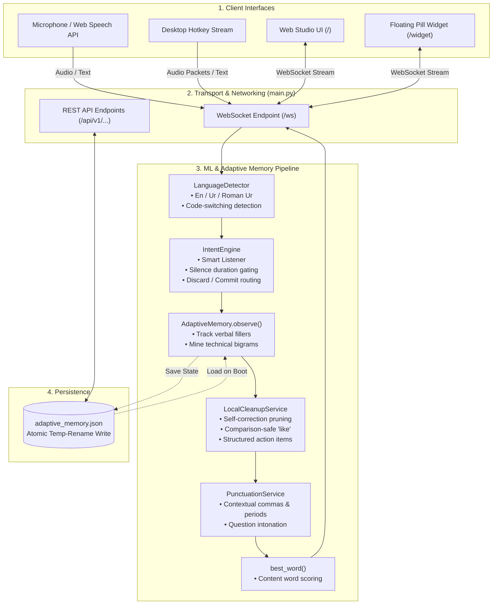

<div align="center">

# 🎙️ VoxFlow ML Engine

**Voice-first real-time transcript refiner with self-learning adaptive memory and zero-hallucination local neural rewrites.**

[](https://www.python.org/)
[](https://fastapi.tiangolo.com/)
[](https://websockets.readthedocs.io/)
[](https://github.com/SYSTRAN/faster-whisper)
[](https://github.com/snakers4/silero-vad)
[](tests)
[](https://pyrefly.org/)

[Features](#-key-features) • [Architecture](#-system-architecture) • [Installation](#-installation--setup) • [Usage](#-usage-guide) • [API Reference](#-api-reference) • [Testing](#-testing--code-quality)

</div>

---

## 🌟 Overview

**VoxFlow ML Engine** transforms unstructured, rambling spoken speech into crisp, structured notes and action items in real time.

Spoken language is naturally messy: it is filled with verbal fillers (*"um"*, *"like"*, *"you know"*), false starts, mid-sentence corrections (*"let's meet at 2... wait, make it 3 PM"*), and informal slang. VoxFlow solves this by coupling **personalized frequency-based adaptive memory** with **100% on-device neural refinement** powered by `faster-whisper`, `silero-vad`, and a specialized local cleanup engine.

The engine serves both an interactive **Web Studio**, a floating **Gooey-Pill Desktop Widget**, and a bidirectional **WebSocket API** for low-latency client integrations.

---

## ✨ Key Features

- **🎙️ Real-Time WebSocket Transport**: Low-latency bidirectional communication for streaming audio acknowledgments and live transcript processing.
- **🧠 Self-Learning Adaptive Memory (`adaptive_memory.py`)**:
  - Tracks individual vocal habits over time.
  - Automatically identifies and suppresses personal filler words once observed $\ge 3$ times (`FILLER_THRESHOLD`).
  - Discovers high-frequency content bigrams to preserve technical domain vocabulary.
  - Atomic, crash-resilient JSON state persistence.
- **⚡ Deterministic Baseline Normalizer (`cleanup_engine.py`)**:
  - Rewrites informal contractions (`wanna` $\rightarrow$ `want to`, `gonna` $\rightarrow$ `going to`, `lemme` $\rightarrow$ `let me`).
  - Resolves casing, contractions (`i'm` $\rightarrow$ `I am`, `thats` $\rightarrow$ `that's`), and sentence-level punctuation.
- **🤖 Zero-Hallucination Local Refinement (`local_cleanup_service.py`)**:
  - 100% on-device neural and rule-based processing (zero cloud LLM dependencies).
  - De-duplicates stuttered ideas and resolves self-corrections into the speaker's final intent.
  - Extracts Markdown action items and bulleted summaries when tasks are detected.
  - Semantic guardrails guarantee 100% intent preservation.
- **🎧 Silero Voice Activity Detection (`vad_service.py`)**:
  - Ultra-fast ONNX-based speech detection with $<4\text{ms}$ frame latency.
  - Emits real-time silence duration for smart conversational commits and trailing thought holding.
- **🔍 Prominence Keyword Scoring**:
  - Extracts the most significant content keyword (`best_word`) ranked by $\text{Length} \times \text{Frequency}$, ignoring stop words.
- **🎨 Glassmorphic Web Studio & Floating Pill Widget**:
  - Modern studio with microphone speech-to-text recording, audio waveform visualizer, multi-stage transcript tabs, and adaptive memory inspection.
  - Standalone floating pill overlay (`/widget`) with fluid SVG metaball animations.

---

## 🏛️ System Architecture

VoxFlow is built around a layered streaming pipeline designed for predictability, sub-millisecond latency, and absolute privacy:



### Component Overview

| Component | File | Description |
| :--- | :--- | :--- |
| **FastAPI Core** | [`main.py`](main.py) | Application gateway, WebSocket endpoint, REST endpoints, and middleware. |
| **ASR Service** | [`asr_service.py`](asr_service.py) | `faster-whisper` CTranslate2 INT8 speech-to-text inference with decoder prompt biasing. |
| **VAD Service** | [`vad_service.py`](vad_service.py) | Silero Voice Activity Detection via ONNX Runtime with silence estimation. |
| **Adaptive Memory** | [`adaptive_memory.py`](adaptive_memory.py) | Learns habitual fillers and vocabulary with atomic JSON storage. |
| **Local Refiner** | [`local_cleanup_service.py`](local_cleanup_service.py) | 100% on-device intent cleanup, self-corrections, and action-item formatting. |
| **Intent Engine** | [`intent_engine.py`](intent_engine.py) | Conversational gating, trailing conjunction holding, and discard phrase parsing. |
| **Job Manager** | [`job_manager.py`](job_manager.py) | Background queue with worker pool, exponential backoff retries, and dead-letter queue. |
| **LRU Cache** | [`cache.py`](cache.py) | In-memory transcript cache for sub-millisecond retrieval. |
| **Web Studio** | [`web_ui.html`](web_ui.html) | Responsive dark-mode single-page app with microphone capture and waveform visualizer. |
| **Floating Widget** | [`widget.html`](widget.html) | Minimalist floating desktop pill utilizing CSS/SVG gooey filters. |

---

## 🚀 Installation & Setup

### Prerequisites
- **Python**: Version `3.10` or higher (tested up to `3.13`).

### 1. 1-Click Install
```bash
# From this directory:
./install.sh

# Or from project root:
../../install.sh
```

### 2. Manual Installation
```bash
python3 -m venv .venv
source .venv/bin/activate
pip install --upgrade pip
pip install -r requirements.txt
```

---

## 💻 Usage Guide

### Starting the Server
```bash
# 1-Click runner
./run.sh

# Or directly with Python
python main.py
```

Once running, access:
- **Interactive Web Studio**: [http://127.0.0.1:8000](http://127.0.0.1:8000)
- **Floating Pill Widget**: [http://127.0.0.1:8000/widget](http://127.0.0.1:8000/widget)
- **API Documentation**: [http://127.0.0.1:8000/docs](http://127.0.0.1:8000/docs)
- **Health Check**: [http://127.0.0.1:8000/health](http://127.0.0.1:8000/health)

### Running Interactive Tools
```bash
# Launch interactive microphone & VAD tester CLI
./run.sh test

# Run Silero VAD latency benchmark
./run.sh benchmark

# Run automated test suite
./run.sh pytest
```

---

## 📡 API Reference

### WebSocket Endpoint: `/ws`

Connect at `ws://127.0.0.1:8000/ws`.

#### Process Transcript
**Request:**
```json
{
  "type": "transcript",
  "text": "um basically what I was thinking is that we need to like check the API response time, no actually it's closer to 2.4 seconds."
}
```

**Response:**
```json
{
  "type": "transcript",
  "raw": "um basically what I was thinking is that we need to like check the API response time, no actually it's closer to 2.4 seconds.",
  "text_baseline": "What I was thinking is that we need to check the API response time, no actually it's closer to 2.4 seconds.",
  "text": "We need to check the API response time, which is actually closer to 2.4 seconds.",
  "best_word": "response",
  "detected_language": "en",
  "language_confidence": 1.0,
  "is_code_switched": false,
  "intent_score": 1.0,
  "memory": {
    "transcript_count": 1,
    "learned_fillers": {
      "basically": 1,
      "um": 1
    },
    "common_phrases": [
      "response time"
    ]
  }
}
```

### REST Endpoints

| Method | Path | Description |
| :--- | :--- | :--- |
| `GET` | `/health` / `/api/v1/health` | Service liveness and operational metrics |
| `GET` | `/memory` | Inspect adaptive memory state and learned fillers |
| `POST` | `/api/v1/refine/sync` | Synchronous transcript refinement |
| `POST` | `/api/v1/jobs/refine` | Submit asynchronous refinement job |
| `GET` | `/api/v1/jobs/{job_id}` | Query background job status |
| `GET` | `/api/v1/jobs/dead-letter` | Inspect dead-letter queue |
| `GET` | `/api/v1/cache/stats` | In-memory LRU cache hit/miss statistics |
| `GET` | `/api/v1/personalization/metrics` | User correction distance and edit rate metrics |
| `POST` | `/api/v1/personalization/vocabulary` | Add custom jargon or proper nouns |

---

## 🧪 Testing & Code Quality

The service maintains a comprehensive 102-test automated suite:

```bash
# Run pytest tests
pytest tests -v

# Run type checker
uvx pyrefly check
```

---

## 📄 License

Licensed under the [MIT License](../../LICENSE).
